# 🏥 MediQ: Evidence-Grounded Medical Question Answering with RAG

> **Research-Oriented AI Application · Retrieval-Augmented Generation (RAG) · NLP · Information Retrieval · LLM Evaluation**  
> *Author:* **Hafiza Sadia Bibi** · [Technical Research Article](./RESEARCH_ARTICLE.md) · [CV Project Description](./CV_PROJECT_DESCRIPTION.md) · [Benchmark Report](./backend/evaluation/results/BENCHMARK_REPORT.md)

[](https://www.python.org/)
[](https://fastapi.tiangolo.com/)
[](https://github.com/facebookresearch/faiss)
[](https://huggingface.co/sentence-transformers/all-MiniLM-L6-v2)
[](https://console.groq.com/)
[-brightgreen.svg)]()

---

## 📌 Project Overview & System Distinction

**MediQ** is a research-grade, evidence-grounded clinical question-answering system powered by Retrieval-Augmented Generation (RAG).

> **Important Distinction for Graduate Admissions (China MS CS/AI-ML) & Research Portfolios:**  
> MediQ is an **advanced RAG-based AI system**, not a foundational base model trained from scratch. Its research contribution centers on **information retrieval precision**, **chunking granularity trade-offs**, **content deduplication**, **mathematically grounded relevance scoring**, and **clinical safety abstention protocols**.

---

## 🔬 Research Question & Key Empirical Findings

### Core Research Question
> *How do chunking strategies, embedding models, and retrieval settings affect evidence retrieval recall, Mean Reciprocal Rank (MRR), and clinical answer faithfulness in a medical RAG system?*

### 📊 Benchmark Matrix (Curated Clinical Guideline Evaluation)

Experiments were executed across controlled hyperparameter settings on standard medical guideline corpora (ADA Standards of Medical Care):

| Configuration ID | Chunk Strategy | Chunk Size | Overlap | Top-$K$ | Recall@$k$ | Precision@$k$ | MRR | Abstention Acc | Retrieval Latency |
|:---|:---|:---:|:---:|:---:|:---:|:---:|:---:|:---:|:---:|
| **EXP-A (Baseline)** | Coarse Window | 1000 chars | 200 | 3 | **79.1%** | 83.3% | **0.917** | 91.7% | 32.4 ms |
| **EXP-B (MediQ Recommended)** | **Balanced Clinical** | **600 chars** | **120** | **3** | **74.6%** | **72.2%** | **0.833** | **100.0%** | **25.6 ms** |
| **EXP-C (Fine-Grained)** | Fine Sub-chunk | 300 chars | 60 | 3 | 67.7% | 72.2% | 0.861 | 91.7% | 24.1 ms |
| **EXP-D (Expanded Top-K)** | Balanced + Deep K | 600 chars | 120 | 5 | 77.4% | 70.0% | 0.833 | 100.0% | 28.4 ms |

### Key Scientific Insights:
1. **The Chunking Granularity Trade-Off:** 600-character chunks (~100 words) provide optimal retention of complex clinical symptom lists without diluting embedding vector density.
2. **Zero-Hallucination Safety Abstention:** Applying a mathematically normalized cosine similarity threshold of `0.35` achieves **100% Abstention Accuracy** on negative and out-of-domain control queries.
3. **Sub-30ms CPU Retrieval:** Dense vector indexing via FAISS and `all-MiniLM-L6-v2` executes in under 30 milliseconds on commodity CPU hardware.

---

## 🚀 Key Architectural Features

### 1. Medical PDF Ingestion with Per-Page Coordinates
- Preserves exact page numbers (`Page 1`, `Page 2`) for every extracted passage.
- Strips PDF formatting artifacts and normalizes line breaks.

### 2. Dual Deduplication Architecture
- **Ingestion Deduplication:** Content-hash filtering (`SHA256`) eliminates repeated headers, legal disclaimers, and duplicate pages prior to indexing.
- **Retrieval Deduplication:** Lexical Jaccard filtering ($J > 0.65$) collapses overlapping chunks and aggregates page numbers (`Pages 1, 2`).

### 3. Mathematically Grounded Cosine Similarity
- Eliminates misleading arbitrary confidence formulas (e.g. `100 - (score * 10)`).
- Formulates exact cosine similarity from $L_2$-normalized FAISS embeddings:
  $$S_{\text{cosine}} = 1 - \frac{d_{L2}^2}{2}$$
- Displays transparent qualitative tiers: **High Relevance ($\ge 70\%$)**, **Moderate ($45\text{--}70\%$)**, and **Marginal ($<45\%$)**.

### 4. Dual Answering Modes (Strict Separation of Attribution)
- **📄 Document Evidence Mode:** Answers strictly grounded in uploaded medical literature with verifiable source cards and page numbers. Abstains if evidence is insufficient.
- **🌐 General Medical Mode:** Broad clinical overviews using LLM parametric knowledge, clearly disclaimed as unverified against uploaded documents.

### 5. Medical Safety & Clinical Red-Flag Triage
- Automated detection of emergency keywords (*crushing chest pain, shortness of breath, anaphylaxis, stroke symptoms, suicidal ideation*).
- Prepends an immediate emergency escalation directive directing users to contact 911 / 112 / 999.

---

## 🏗️ System Architecture

```mermaid
flowchart TD
    subgraph Ingestion["Document Ingestion Engine"]
        A["Medical PDF"] --> B["pypdf Per-Page Parser"]
        B --> C["Recursive Character Splitter"]
        C --> D["Content-Hash Deduplicator"]
        D --> E["all-MiniLM-L6-v2 Embeddings"]
        E --> F[("FAISS Local Vectorstore")]
    end

    subgraph DualMode["Dual-Mode Inference Engine"]
        Q["User Question"] --> EM["Emergency Red-Flag Scanner"]
        EM --> M{"Selected Answering Mode?"}
        
        M -->|"Document Mode"| RET["FAISS Top-2K Retrieval"]
        RET --> DEDUP["Jaccard Deduplication"]
        DEDUP --> CHECK{"Max Relevance >= 0.35?"}
        CHECK -->|"No"| ABS["Abstain: Insufficient Evidence"]
        CHECK -->|"Yes"| LLM1["Groq Qwen 3.8 27B / GPT-OSS"]
        LLM1 --> OUT1["Evidence Answer + Document Citations"]

        M -->|"General Mode"| LLM2["Groq Qwen 3.8 27B / GPT-OSS"]
        LLM2 --> OUT2["General Clinical Overview + Disclaimer"]
    end
```



---

## 📂 Repository Structure

```
Professional-Medical-RAG-Portal/
├── backend/
│   ├── config.py                  # Central configuration, models, thresholds & emergency flags
│   ├── main.py                    # FastAPI application, static routing, evaluation endpoints
│   ├── evaluation/
│   │   ├── data/
│   │   │   └── medical_eval_benchmark.json   # 12-sample curated guideline benchmark dataset
│   │   ├── results/
│   │   │   ├── benchmark_summary.json       # Quantitative experiment results
│   │   │   ├── benchmark_summary.csv        # Tabular metrics export
│   │   │   └── BENCHMARK_REPORT.md          # Comprehensive academic evaluation report
│   │   ├── metrics.py             # Recall@k, Precision@k, MRR, Faithfulness, Token-F1
│   │   └── run_experiments.py     # Grid search experiment runner across 4 configurations
│   └── rag/
│       ├── chain.py               # Dual-mode answering, red-flag scanner & Groq LLM integration
│       ├── embeddings.py          # L2-normalized HuggingFace embeddings & FAISS persistence
│       ├── pdf_loader.py          # Per-page text extraction with metadata
│       ├── retriever.py           # Cosine distance conversion, deduplication & thresholding
│       └── text_splitter.py       # Semantic splitting & content-hash deduplication
├── frontend/
│   ├── pages/
│   │   ├── index.html             # Landing portal showcasing system architecture & capabilities
│   │   ├── chat.html              # Dual-mode chat UI with verified citations & latency pills
│   │   ├── upload.html            # Drag-and-drop PDF ingestion & vectorstore manager
│   │   ├── research.html          # Interactive empirical benchmark dashboard & dataset viewer
│   │   └── about.html             # System design, clinical ethics & tech stack details
│   └── static/
│       ├── css/ (global.css, chat.css, upload.css)
│       └── js/ (utils.js)
├── tests/
│   └── test_rag_pipeline.py       # Automated test suite (7 comprehensive test cases)
├── RESEARCH_ARTICLE.md            # Publication-ready technical paper for Medium/arXiv
├── requirements.txt               # Locked production dependencies
├── run.py                         # One-command application launcher
└── README.md                      # Academic & technical portfolio documentation
```

---

## ⚡ Quick Start & Reproducibility Guide

### 1. Clone & Set Up Environment

```bash
git clone https://github.com/Hafiza-sadia/Professional-Medical-RAG-Portal.git
cd Professional-Medical-RAG-Portal

# Create and activate virtual environment
python -m venv venv
# On Windows:
.\venv\Scripts\activate
# On Linux/macOS:
source venv/bin/activate

# Install dependencies
pip install -r requirements.txt
```

### 2. Configure Environment Variables
Create a `.env` file in the repository root:
```env
GROQ_API_KEY=gsk_your_actual_groq_api_key_here
```
> Get a free Groq API key with fast Qwen 3.8 27B / GPT-OSS access at [console.groq.com](https://console.groq.com/keys).

### 3. Run Automated Tests
```bash
pytest tests/test_rag_pipeline.py -v
```
*(All 7 tests verify PDF loading, deduplication, cosine similarity, abstention, dual modes, and API endpoints).*

### 4. Run Research Benchmark Experiments
```bash
python -m backend.evaluation.run_experiments
```
*(Executes grid search across 4 configurations, calculates Recall@k and MRR, and updates `BENCHMARK_REPORT.md`).*

### 5. Launch the Web Portal
```bash
python run.py
```
Open **`http://localhost:8000`** in your browser:
- 💬 **Evidence Chat:** `http://localhost:8000/chat`
- 📤 **PDF Ingestion:** `http://localhost:8000/upload`
- 📊 **Research Benchmark:** `http://localhost:8000/research`
- 📚 **Swagger API Docs:** `http://localhost:8000/docs`

---

## 📖 Citation & Academic Publication

If you reference this implementation or benchmark in your research, thesis, or portfolio:

```bibtex
@article{sadia2026mediq,
  title={MediQ: Empirical Evaluation of Chunking Strategies, Embedding Models, and Retrieval Settings on Evidence Grounding in Medical RAG Systems},
  author={Sadia Bibi, Hafiza},
  journal={GitHub Repository Preprint},
  year={2026},
  url={https://github.com/Hafiza-sadia/Professional-Medical-RAG-Portal}
}
```

---

## ⚖️ Clinical Disclaimer

*MediQ is an experimental research system engineered for informational and educational investigation of retrieval-augmented clinical NLP. It is not approved for clinical diagnostic decision-making, pharmacological prescribing, or emergency triage. Always consult a licensed medical practitioner for healthcare decisions.*